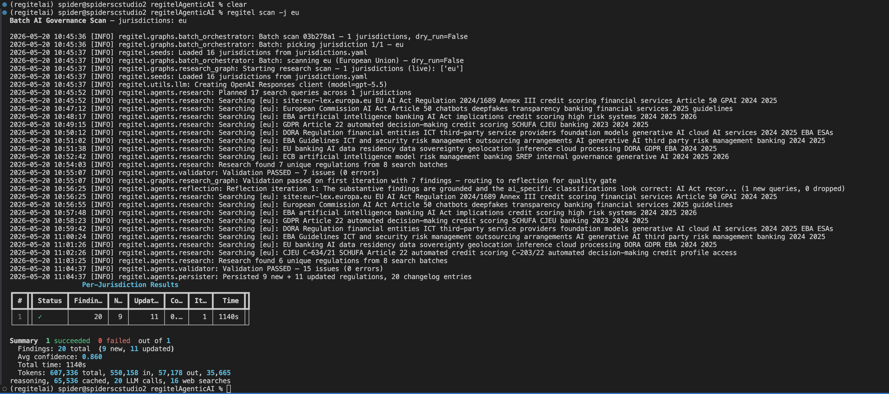
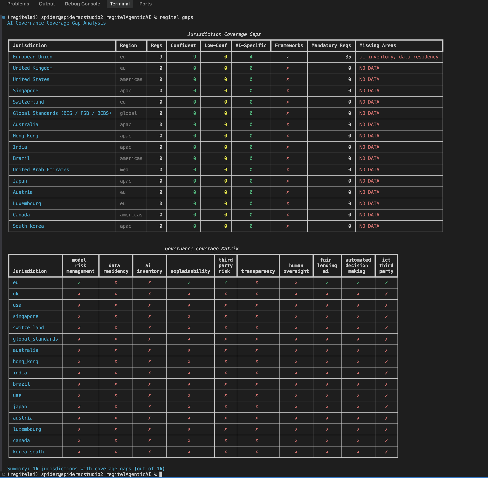

# RegIntel — Quick Start (OpenAI Responses)

Live LLM inference and web search use OpenAI Responses API. Embeddings and storage remain local.

## Prerequisites

- Python 3.10+
- An OpenAI API key with access to the configured Responses model

## Installation

```bash
# Clone the repo
git clone https://github.com/yourusername/regitel.git
cd regitel

# Install with editable install (includes OpenAI, LangGraph, sentence-transformers, etc.)
pip install -e ".[dev]"

# Configure
cp .env.example .env
# Edit .env and set:
#   - OPENAI_API_KEY: your OpenAI API key
#   - OPENAI_MODEL: the Responses model to use, e.g. gpt-5.5
```

## First Run

```bash
# Initialize databases, seed jurisdictions, and download the embedding model (~200MB, one-time)
regitel db init --seed

# Check everything is working
regitel doctor
```

The `doctor` command will verify:
- ✓ Database exists
- ✓ OpenAI API key is configured
- ✓ OpenAI model is configured
- ✓ No duplicate regulations

Completed research runs store OpenAI usage totals, including input, output,
cached input, reasoning tokens, LLM call count, and web search call count.

## Scan Your First Jurisdiction

```bash
# Research GenAI regulations for the EU (AI Act, GDPR Art. 22)
regitel scan -j eu

# Research US GenAI regulations (NY DFS, CFPB, OCC)
regitel scan -j usa

# Scan all priority jurisdictions
regitel scan --all
```



```
# Dry run (no actual model calls)
regitel scan -j eu --dry-run
```

## Query the Database

```bash
# Natural language search (uses local embeddings)
regitel query semantic "model risk management for generative AI"

# Structured search
regitel query search -t "AI Act"
regitel query search --region europe

# Compare jurisdictions side-by-side
regitel query compare eu usa singapore

# Coverage gap analysis
regitel gaps

# Governance matrix for specific jurisdictions
regitel matrix eu usa

# Framework summary
regitel frameworks
```




## Build Vector Embeddings

After scanning, build local embeddings for semantic search:

```bash
# First time (or after new regulations are added)
regitel db embed

# Force re-embed all
regitel db embed --force
```


## Export Findings

```bash
# Full export as JSON
regitel export json

# Export only AI-specific regulations
regitel export json --ai-specific-only

# Export only applied regulations (existing rules applied to AI)
regitel export json --applied-only

# Export as CSV
regitel export csv

# Export as summary
regitel export summary
```

## Architecture Overview

| Component | Technology | Location |
|---|---|---|
| LLM (all 4 agents) | OpenAI Responses API | OpenAI |
| Embeddings | all-MiniLM-L6-v2 | Local (sentence-transformers) |
| Web Search | OpenAI hosted web search | OpenAI |
| Database | SQLite | Local file |
| Vector Store | ChromaDB | Local file |

Live research calls OpenAI for both LLM inference and web search. Embeddings run locally via sentence-transformers.

## Changing the Model

Edit `regitel.yaml` or set `OPENAI_MODEL` to change the Responses model:

```yaml
llm:
  model: gpt-5.5
```

Or set via environment variable:
```bash
OPENAI_MODEL=gpt-5.5
```

## Troubleshooting

**OpenAI authentication errors:** Confirm `OPENAI_API_KEY` is set in `.env` and has access to `OPENAI_MODEL`.

**ChromaDB errors:** Delete `~/.regitel/data/chroma/` and re-run `regitel db embed`.

**Web search errors:** Hosted search uses the configured OpenAI model and may incur tool-call charges.

## Running Tests

```bash
# Run all tests (uses mock LLM/search — no OpenAI calls needed)
pytest

# Run with verbose output
pytest -v

# Run specific test file
pytest tests/test_agents.py -v
```
