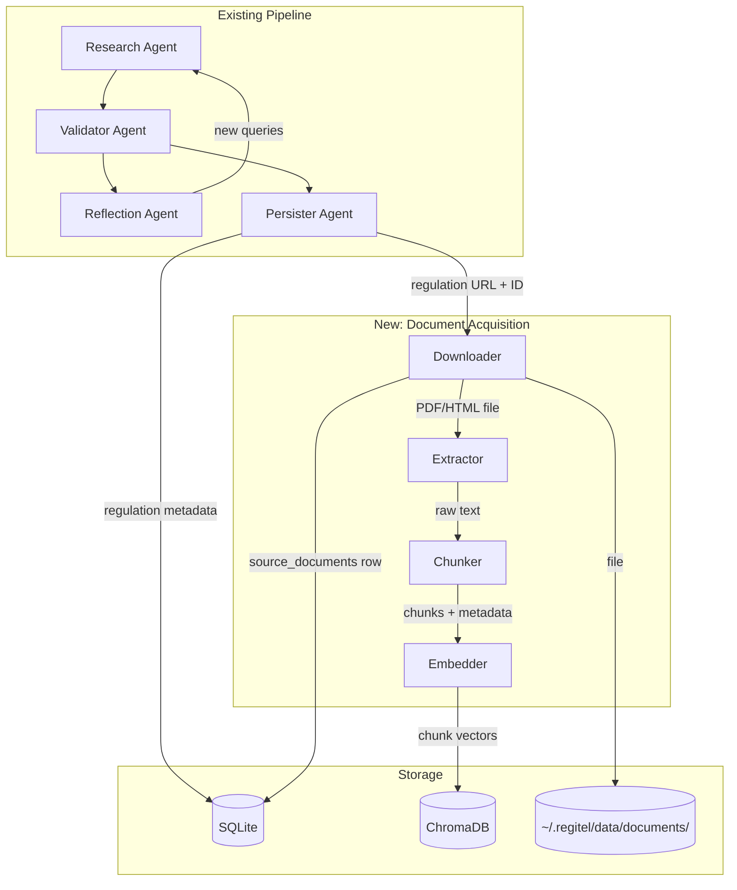
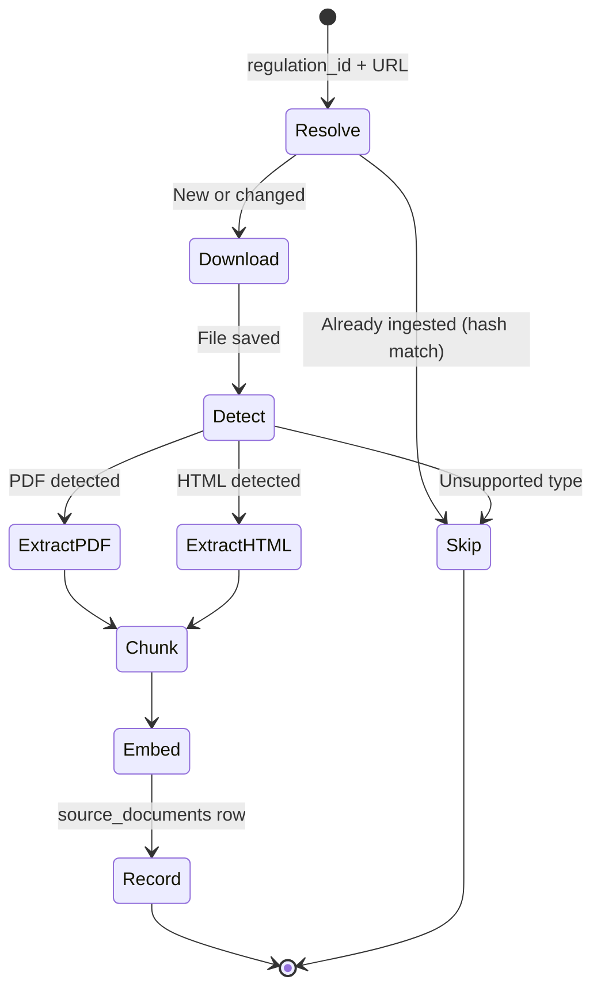
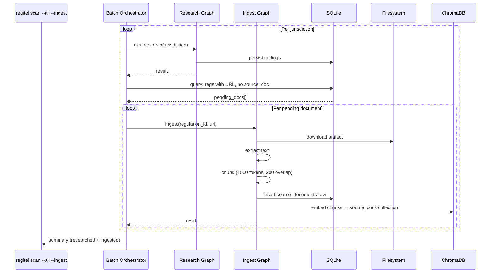

# Document Acquisition & Ingestion Pipeline — Design

> **Status:** Draft
> **Date:** 2026-03-29
> **Scope:** Extend RegIntel to download, extract, chunk, and embed the actual regulation artifacts (PDFs, HTML) discovered during research scans.

---

## 1. Problem Statement

The current pipeline discovers regulation **metadata** via web search (Tavily) and stores structured records (name, issuing body, URL, pentest requirements) in SQLite. ChromaDB embeddings are built from this metadata text only.

This means:

- Semantic search can find **which** regulation exists, but not **what it says**.
- You cannot ask "what does DORA Article 26 say about pooled testing?" because the actual document text was never ingested.
- Confidence scores are based on search-snippet quality, not authoritative source verification.
- The `source_documents` table and `IngestState` model exist but are not wired in.

## 2. Desired End State

After a `regitel scan --all`, every regulation with a valid URL should also have:

1. The source artifact downloaded to `~/.regitel/data/documents/{jurisdiction}/{filename}`
2. A `source_documents` row linking it to the regulation, with file hash and page count
3. The full extracted text chunked and embedded into a new ChromaDB collection (`source_docs`)
4. The ability to answer deep questions like "what section of CPS 234 covers penetration testing scope?"

## 3. Architecture

### 3.1 Pipeline Overview



### 3.2 New LangGraph: Ingest Graph

The document acquisition runs as a **separate graph** invoked after the persister, not inline with the research loop. This keeps the research pipeline fast and allows re-ingestion without re-researching.



### 3.3 Batch Integration

The batch orchestrator (`regitel scan`) gains an optional `--ingest` flag. When enabled, after each jurisdiction's research+persist completes, the ingest graph runs for every regulation that has a URL but no `source_documents` entry (or whose URL changed since last ingest).



## 4. Component Design

### 4.1 Downloader

**Responsibility:** Fetch the artifact at a given URL. Handle redirects, rate-limiting, and content-type detection.

| Decision | Choice | Rationale |
|----------|--------|-----------|
| HTTP client | `httpx` (async-capable) | Already in LangChain deps; handles redirects, timeouts, retries |
| Storage path | `~/.regitel/data/documents/{jurisdiction_id}/{hash[:8]}_{filename}` | Avoids collisions; hash prefix allows dedup |
| Dedup strategy | SHA-256 of file content → `file_hash` column | If hash matches existing, skip re-extraction |
| Rate limiting | 2 req/sec per domain, configurable | Respect regulator servers; avoid bans |
| Max file size | 50 MB default (configurable) | Some regulatory docs are large; cap prevents runaway |
| Timeout | 60 seconds per download | Regulatory servers can be slow |
| Retry | 3 attempts with exponential backoff | Transient failures common |
| User-Agent | `RegIntel/1.0 (regulatory-research)` | Transparent about purpose |

**Content-type handling:**

| Content-Type | Action |
|---|---|
| `application/pdf` | Save as `.pdf`, route to PDF extractor |
| `text/html` | Save as `.html`, route to HTML extractor |
| `application/vnd.openxmlformats...` (DOCX) | Save as `.docx`, route to DOCX extractor |
| Other | Log warning, skip, mark `document_type = "unsupported"` |

### 4.2 Extractor

**Responsibility:** Convert downloaded artifacts into clean plain text.

| Format | Library | Notes |
|--------|---------|-------|
| PDF | PyMuPDF (`fitz`) | Already in project (`validate/pdf_extract.py`). Handles most regulatory PDFs well. Falls back gracefully on scanned docs. |
| HTML | `trafilatura` or `beautifulsoup4 + readability` | Extracts main content, strips nav/ads. Many regulatory sites are HTML-first. |
| DOCX | `python-docx` | Rare but some regulators publish in Word. |

The existing `extract_pdf()` in `validate/pdf_extract.py` can be reused directly. We promote it to a shared utility and add HTML/DOCX extractors alongside it.

**Text cleaning pipeline:**

1. Strip headers/footers (page numbers, copyright lines — regex patterns)
2. Normalize whitespace (collapse multiple newlines to double)
3. Remove non-content pages (table of contents, blank pages)
4. Detect language (store as metadata — important for non-English jurisdictions)

### 4.3 Chunker

**Responsibility:** Split extracted text into overlapping chunks suitable for embedding.

| Parameter | Default | Rationale |
|-----------|---------|-----------|
| Chunk size | 1000 tokens (~4000 chars) | Balances context window vs. granularity for retrieval |
| Overlap | 200 tokens (~800 chars) | Ensures cross-boundary concepts are captured |
| Strategy | Recursive character splitter | LangChain's `RecursiveCharacterTextSplitter` — splits on paragraphs → sentences → words |
| Metadata per chunk | `regulation_id`, `jurisdiction_id`, `source_doc_id`, `chunk_index`, `page_range` | Rich filtering at query time |

**Section-aware chunking (stretch goal):**

For PDFs with clear section headers (e.g., "Article 26", "Section 5.3"), detect section boundaries and prefer splitting at them. This keeps regulatory articles intact and makes retrieval much more meaningful.

### 4.4 Embedder

**Responsibility:** Embed chunks into ChromaDB.

| Decision | Choice | Rationale |
|----------|--------|-----------|
| Collection name | `source_docs` (new, 4th collection) | Separate from metadata embeddings — different content type, different search use-case |
| Embedding model | ChromaDB default (`all-MiniLM-L6-v2`) for now | Consistent with existing collections; upgrade path to OpenAI `text-embedding-3-small` later |
| Batch size | 50 chunks per add | Same as existing pipeline |
| Metadata | `regulation_id`, `jurisdiction_id`, `source_doc_id`, `chunk_index`, `page_range`, `document_type` | Enable filtered search |

### 4.5 Schema Changes

**`source_documents` table** — already exists, needs two new columns:

```sql
ALTER TABLE source_documents ADD COLUMN text_length INTEGER;      -- extracted text char count
ALTER TABLE source_documents ADD COLUMN chunk_count INTEGER;       -- number of chunks embedded
ALTER TABLE source_documents ADD COLUMN language VARCHAR(10);      -- detected language (ISO 639-1)
ALTER TABLE source_documents ADD COLUMN download_status VARCHAR(20) DEFAULT 'pending';
    -- pending | downloaded | extracted | embedded | failed | skipped
```

**`vectorstore.py`** — add 4th collection constant:

```python
SOURCE_DOCS = "source_docs"
ALL_COLLECTIONS = [REGULATION_TEXTS, PENTEST_GUIDANCE, RESEARCH_CACHE, SOURCE_DOCS]
```

## 5. CLI Interface

```
regitel scan --all --ingest          # research + download + embed
regitel scan -j eu --ingest          # single jurisdiction

regitel ingest                       # ingest all pending (URL exists, no source_doc)
regitel ingest -j eu                 # ingest for one jurisdiction
regitel ingest --re-embed            # re-chunk and re-embed existing documents

regitel query semantic "DORA Article 26 pooled testing" --collection source_docs
regitel query semantic "CPS 234 penetration scope" -j australia --collection source_docs
```

## 6. Dual-LLM Considerations

Document acquisition is mostly **non-LLM work** (download, extract, chunk, embed). The only LLM-adjacent step is the embedding model inside ChromaDB.

However, a future enhancement could use the **local LLM** (Qwen 3.5 122B) for:

- **Summarization:** Generate a 2-paragraph summary of each document for the `source_documents` table
- **Section extraction:** Ask the LLM to identify which sections specifically discuss penetration testing
- **Cross-reference:** After ingesting a new version, ask the LLM "what changed between v1 and v2?"

These are Phase 8+ enhancements.  The initial implementation is pure extraction — no LLM calls.

## 7. Error Handling & Edge Cases

| Scenario | Handling |
|----------|----------|
| URL returns 403/404 | Mark `download_status = "failed"`, log reason, continue |
| URL redirects to login page | Detect by checking for `<form>` with password fields; mark as `"auth_required"` |
| PDF is scanned image (no text) | `fitz` returns near-empty text; mark `"ocr_needed"`, skip embedding |
| File exceeds 50 MB | Skip with warning, mark `"too_large"` |
| Non-English document | Detect language, store in metadata, embed anyway (MiniLM handles multilingual) |
| URL points to landing page, not PDF | Extract HTML content; may be useful but flag `document_type = "landing_page"` |
| Duplicate files (same hash) | Skip re-extraction, link new regulation to existing source_doc |
| Rate-limited (429) | Exponential backoff up to 3 retries, then mark `"rate_limited"` |

## 8. Implementation Phases

### Phase 7A — Downloader + Extractor (core pipeline)

- `regitel/agents/downloader.py` — HTTP fetch with retry/rate-limit
- Promote `validate/pdf_extract.py` → `regitel/extractors/pdf.py`
- New: `regitel/extractors/html.py`
- Schema migration: add columns to `source_documents`
- `regitel ingest` CLI command

### Phase 7B — Chunker + Embedder

- `regitel/extractors/chunker.py` — recursive splitter with metadata
- Add `SOURCE_DOCS` collection to vectorstore
- Wire into `populate_embeddings()` or create `populate_source_embeddings()`
- `regitel query semantic --collection source_docs`

### Phase 7C — Batch Integration

- Wire `--ingest` flag into `batch_orchestrator.py`
- Post-persist hook: query for pending docs, invoke ingest graph
- Summary table shows ingested doc counts alongside research results

### Phase 7D — Hardening

- Tests: mock downloads, extraction, chunking, embedding
- `regitel doctor` checks: orphan source_docs, missing files, embedding gaps
- Rate-limit configuration in `regitel.yaml`
- `regitel ingest --status` — show download/extraction/embedding status per jurisdiction

## 9. Storage Estimates

| Metric | Estimate | Notes |
|--------|----------|-------|
| Avg PDF size | 2–5 MB | Regulatory documents tend to be 20-200 pages |
| 20 jurisdictions × ~5 docs each | ~100 documents | Conservative estimate |
| Raw storage | ~300–500 MB | Manageable for local disk |
| Text per document | ~50–200 KB | After extraction |
| Chunks per document (1000-token) | ~20–80 | Depends on document length |
| Total chunks | ~2,000–8,000 | For 100 documents |
| ChromaDB storage (source_docs) | ~50–100 MB | With default embeddings |

## 10. Configuration (`regitel.yaml`)

```yaml
ingest:
  enabled: true
  max_file_size_mb: 50
  rate_limit_per_second: 2
  download_timeout_seconds: 60
  retry_attempts: 3
  chunk_size_tokens: 1000
  chunk_overlap_tokens: 200
  user_agent: "RegIntel/1.0 (regulatory-research)"
  supported_types:
    - application/pdf
    - text/html
  documents_path: "~/.regitel/data/documents"
```

## 11. Open Questions

1. **OCR for scanned PDFs?** — Some older regulatory documents are scanned images. Adding Tesseract/`pytesseract` would handle these but adds complexity. Defer to Phase 8?

2. **Versioning:** When a regulation is updated and the URL changes, should we keep the old document or replace it? Recommendation: keep both, add a `superseded_by` link.

3. **Authentication:** Some regulator portals (e.g., HKMA, MAS) require login to download documents. Should we support cookie-based auth or API keys? Defer to Phase 8 with a "manual ingest" path for authenticated docs.

4. **Embedding model upgrade:** The default `all-MiniLM-L6-v2` is good for short text but may underperform on 1000-token chunks of dense regulatory language. Consider upgrading to `text-embedding-3-small` (OpenAI) or `bge-large-en-v1.5` for the `source_docs` collection.
